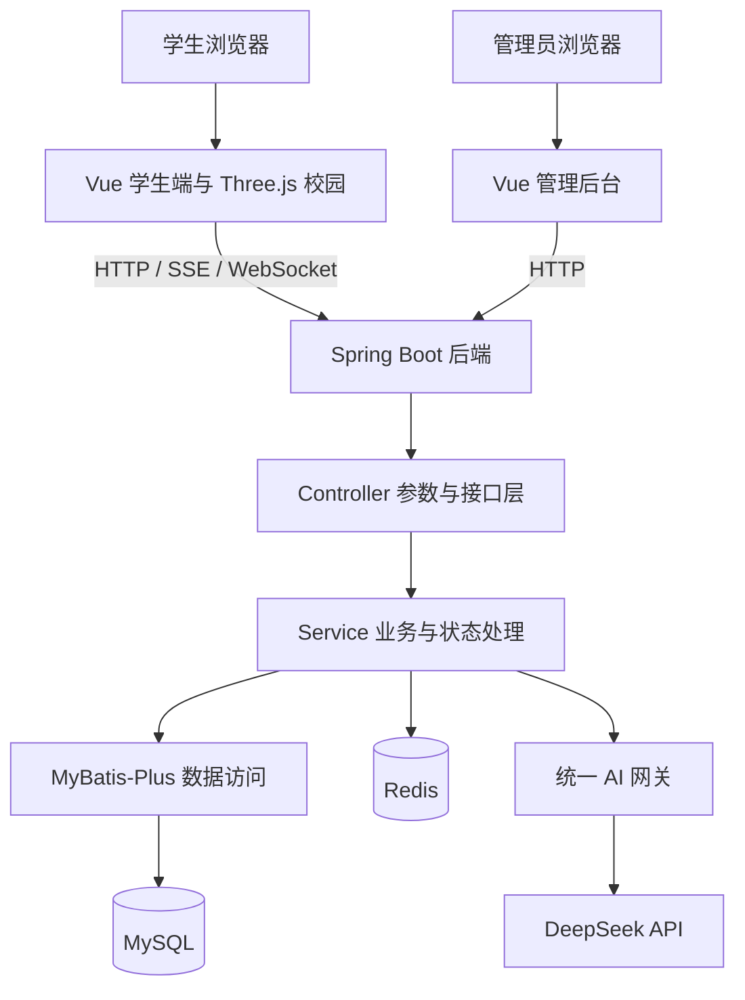

# 三维交互式智慧校园服务平台

基于 **Spring Boot + Vue 3** 的校园综合服务项目，将校园活动、闲置互换、失物招领、学习互助、实时社交和 AI 学习组织到同一平台，并提供可漫游、可办理业务的三维校园空间。

项目包含 **Web 学生端、Web 管理后台和 Spring Boot 后端**。界面中使用“梧桐校园”作为站点展示名称，可作为《基于 Spring Boot 的三维交互式智慧校园服务平台的设计与实现》的毕业设计项目基础。

[项目特点](#项目特点) · [功能说明](#功能说明) · [技术架构](#技术架构) · [快速启动](#快速启动) · [项目结构](#项目结构) · [开发与测试](#开发与测试) · [部署说明](./部署说明.md)

## 项目特点

### 三维空间与校园服务结合

学生可以从首页进入 `/campus-3d`，在“梧桐中庭”及各分区漫游，走进服务房间后直接使用活动、交易、问答、聊天和 AI 学习等功能。三维入口与普通网页共用学生端组件、账号状态和后端数据，在房间中打开详情、发布内容或进入私信时，浏览器地址仍保持在三维校园页面。

空间层负责场景与移动，业务层复用已有页面，便于继续增加服务入口。

### AI 融入学习、生活和内容治理

AI 能力覆盖智能对话、PDF 问答、代码纠错、错题整理与复习，也用于活动推荐、闲置估价、失物匹配、学习搭子匹配、发布文案辅助和内容风险预审。校园向导可检索当前业务数据，再将相关信息提供给模型组织回答。

### 业务流程与实时互动

活动包含报名、审批、取消报名和签到；闲置包含预约、处理、完成和评价；失物招领包含认领申请、核实和确认。私信和“你画我猜”分别使用 WebSocket 实现实时通信，AI 对话支持 SSE 流式输出。

### 学生使用与后台治理配套

后台提供运营统计、用户管理、内容审核、举报处理、公告管理和 AI 配置。内容预审结合本地风险词规则与外部模型，低风险内容可自动通过，中高风险内容保留人工复核入口。

## 功能说明

### 学生端

| 模块 | 已有功能 |
|---|---|
| 账号与资料 | 学号注册、学生登录、验证码界面与校验开关、资料及头像修改、密码修改；注册页含人机交互校验 |
| 校园首页 | 公告、活动、闲置、失物信息聚合，常用服务入口，活动／闲置／失物／动态搜索 |
| 校园活动 | 列表与筛选、详情、发布与编辑、AI 文案辅助、报名及取消报名、报名审批、签到二维码与签到、我的发布与报名、AI 活动推荐 |
| 闲置互换 | 发布与编辑、分类浏览、详情、收藏、预约、发布者接受或拒绝预约、交易完成、评价、下架及重新上架、AI 参考估价 |
| 失物招领 | 寻物／招领发布、浏览与检索、编辑、AI 候选匹配、认领申请、发布者核实、申请人确认领取、完成标记 |
| 学习搭子 | 按学科与关键词浏览、发布学习需求、查看我的发布、AI 匹配与推荐理由、标记已找到 |
| 互助问答 | 提问、问题浏览与详情、回答、提问者采纳答案、AI 参考回答、我的提问与回答 |
| 动态广场 | 发布动态、AI 文案辅助、查看详情、点赞及取消点赞、评论 |
| 公告与通知 | 公告列表与详情、站内消息分类、未读数量、单条及全部已读 |
| 实时私信 | 会话列表、历史消息、文字及图片消息、未读提示、业务上下文卡片、隐藏会话、拉黑及取消拉黑、聊天消息举报 |
| 个人中心 | 我的闲置、报名、错题和收藏入口，个人资料管理；他人主页聚合其闲置、活动、失物、动态和评价 |
| 内容反馈 | 内容／用户举报、后台处理；业务操作与审核结果通过消息通知用户 |
| 多人游戏 | 你画我猜大厅、公开／私密房间、房间码与密码加入、实时画板和猜词聊天、回合计时与计分、游戏记录及作品画廊 |
| 界面与导航 | 明暗主题切换及状态保存、桌面与窄屏布局、手机导航菜单 |

### AI 学习与业务辅助

| 场景 | 功能与实现方式 |
|---|---|
| 智能对话 | 新建、重命名和删除会话，保存历史消息，SSE 流式答复 |
| PDF 学习问答 | 上传文本型 PDF，使用 PDFBox 提取文字，绑定学习会话并针对文档提问 |
| 校园向导 | 根据问题关键词查询活动、个人报名、闲置、失物、动态和公告等业务数据，提供带业务上下文的回答 |
| 代码纠错 | 提交代码与问题描述，获取错误分析、修改建议和修复结果 |
| 错题录入 | 手动收录或通过题目图片进行 OCR 文字识别，支持后续人工编辑 |
| 错题整理与讲解 | AI 归纳学科、章节、题型、难度、知识点及错因，生成题目讲解 |
| 练习与复习 | AI 生成同类题、保存练习题到错题本、根据全部或选中错题生成复习提纲、生成复习计划；根据复习反馈更新掌握状态和下次复习时间 |
| 薄弱点分析 | 按已收录错题统计知识点、错因分布和高频错题，生成统计型报告 |
| 发布辅助 | 为活动、闲置、失物及动态生成标题、正文与标签，提供润色、扩写和精简 |
| 失物匹配 | 从已有拾到记录中筛选候选，返回可能匹配的记录与理由 |
| 闲置估价 | 根据描述给出参考价格区间、定价建议及发布卖点 |
| 搭子与活动推荐 | 结合学习目标、时间安排或历史报名偏好推荐候选，并给出理由 |
| 互助参考回答 | 为校园问题生成可供学生参考的答案 |
| 内容风险预审 | 返回风险等级与原因，与本地规则及人工审核流程衔接 |

**能力边界：**AI 使用外部 DeepSeek 接口，需要有效服务密钥；项目未训练大模型。OCR 在浏览器中通过 Tesseract.js 执行，相关识别资源存放于 `public/ocr/`。PDF 上传解析面向可提取文本的文档，扫描件不会自动转为可问答文本。校园向导中的图书馆、食堂等部分静态信息仍为示例占位，正式使用时应替换为实际校园信息。AI 参考答案、估价和推荐结果需要结合具体情况判断。

### 三维校园

| 空间 | 服务房间 |
|---|---|
| 梧桐中庭 | 综合门户与各分区导览 |
| 校园服务区 | 校园活动、闲置互换、学习搭子、失物招领 |
| 社交信息区 | 互助问答、动态广场、你画我猜、校园公告、消息中心 |
| AI 学习区 | AI 答疑、代码纠错、错题本 |

三维校园共设置 **12 个服务房间**，支持拖动环视、WASD 移动、点击门和服务台交互、导览定位、返回中庭、全屏及画质切换。房间内提供返回上一级、返回房间和服务加载重试，列表筛选与分页状态可在房间内返回时恢复。

场景使用 Three.js 构建，是校园服务的空间化入口。

### 管理后台

| 模块 | 已有功能 |
|---|---|
| 数据总览 | 核心业务指标、趋势、模块分布及待办统计 |
| 用户管理 | 用户查询、启用／禁用、密码重置 |
| 内容审核 | 活动、闲置、失物、动态、搭子五类发布内容审核，查看 AI 风险等级、原因与审核来源 |
| AI 内容审核 | 按审核结果与风险筛选内容，人工复核、恢复展示或维持拦截 |
| 内容管理 | 活动、闲置、失物、动态、搭子、问答六类内容管理，下架与恢复 |
| 举报处理 | 查看举报详情并处理内容、用户或聊天相关举报 |
| 公告管理 | 公告新建、编辑、发布、下线与删除 |
| 活动报表 | 查看报名／签到统计，导出报名名单和签到名单，文件格式为 CSV |
| AI 配置 | 服务地址、密钥、模型及参数配置，提示词模板新建与编辑 |
| AI 调用日志 | 查询调用记录、场景、Token 用量、耗时及结果 |
| 系统配置 | 站点信息、维护模式、注册开关、AI 审核开关、高／中风险词等配置 |
| 管理员管理 | 子管理员列表、新建与编辑，区分超级管理员和审核员角色 |

学生与管理员分别登录，后端校验 JWT 角色；部分系统配置和管理员管理操作仅允许超级管理员访问。

### 主要业务流程

- **活动：**发布 → 内容审核 → 浏览与报名 → 发布者审批 → 签到 → 报名／签到统计与导出。
- **闲置：**发布 → 内容审核 → 预约 → 发布者接受或拒绝 → 完成 → 评价。
- **失物：**发布寻物或招领 → 内容审核 → 检索／匹配 → 申请认领 → 发布者核实 → 确认领取。
- **错题：**手动／OCR 录入 → 编辑与 AI 整理 → 讲解与同类题 → 复习反馈 → 更新掌握状态和复习时间。
- **内容治理：**本地规则／AI 预审 → 低风险自动通过或进入人工复核 → 展示／驳回；已发布内容还可通过举报、下架和恢复流程处理。

## 技术架构



| 层次 | 技术 |
|---|---|
| 后端基础 | Java 17、Spring Boot 3.2.5、Spring MVC、Validation |
| 数据与缓存 | MyBatis-Plus 3.5.7、MySQL 8、Redis；Compose 使用 Redis 7 |
| 实时通信 | Spring WebSocket；AI 答复使用 SSE |
| 身份与校验 | JWT、BCrypt 密码散列、业务资源归属校验、可信 Origin 配置 |
| AI 与文档 | DeepSeek OpenAI 兼容接口、OkHttp、PDFBox 3.0.2 |
| Web 前端 | Vue 3、Vite 6、Vue Router、Pinia、Element Plus、Axios |
| 展示与编辑 | ECharts、Markdown It、Highlight.js、WangEditor、Monaco Editor |
| 三维与 OCR | Three.js、Tesseract.js 7 |
| 部署 | Docker Compose、Nginx、多阶段镜像构建 |

后端按业务模块划分 Controller、Service、Mapper、DTO 和 VO。AI 场景统一通过网关调用，网关负责提示词、上下文、调用日志及部分调用额度控制。图片和上传资源以 Data URI／Base64 方式存入数据库，MinIO 接口主要用于兼容既有资源访问。

## 快速启动

### 使用 Docker Compose

需要安装 Git 和支持 Compose 的 Docker 环境。首次构建需要联网下载镜像与项目依赖。

下面以 Windows PowerShell 为例：

```powershell
git clone https://github.com/hongyucheng6258-glitch/Graduation-Project.git
Set-Location Graduation-Project

if (-not (Test-Path -LiteralPath .env)) {
    Copy-Item -LiteralPath .env.example -Destination .env
}
notepad .env
```

在 `.env` 中填写以下配置：

| 配置项 | 说明 |
|---|---|
| `MYSQL_ROOT_PASSWORD` | 必填，数据库密码 |
| `REDIS_PASSWORD` | 必填，Redis 服务与后端客户端共用密码 |
| `JWT_SECRET` | 必填，至少 32 个字符的随机签名密钥 |
| `SIGNIN_SECRET` | 必填，至少 16 个字符的随机签到密钥 |
| `AI_API_KEY` | 使用 AI 能力时填写有效密钥，也可在管理后台配置 |
| `STUDENT_PORT` / `ADMIN_PORT` | 模板使用 15173 / 15174 |
| `TRUSTED_ORIGINS` | 已包含模板前端地址；修改端口或域名时同步调整 |

然后启动：

```powershell
docker compose up -d --build
docker compose ps
```

Compose 会启动 MySQL、Redis、后端、学生端和管理端。已有镜像和数据卷时，可使用 `docker compose up -d` 恢复运行。

### 访问地址

以下地址对应仓库 `.env.example` 中的端口：

| 服务 | 地址 |
|---|---|
| 学生端 | [http://localhost:15173/](http://localhost:15173/) |
| 三维校园 | [http://localhost:15173/campus-3d](http://localhost:15173/campus-3d) |
| 管理后台 | [http://localhost:15174/admin/](http://localhost:15174/admin/) |
| 后端存活检查 | [http://localhost:8080/healthz](http://localhost:8080/healthz) |
| 数据库与 Redis 就绪检查 | [http://localhost:8080/readyz](http://localhost:8080/readyz) |

未配置 `STUDENT_PORT`、`ADMIN_PORT` 时，Compose 默认映射到 5173、5174。Windows 若将这两个端口划入系统保留范围，可使用模板中的 15173、15174。

### 演示账号

首次使用 Compose 创建 MySQL 数据卷并成功执行演示 SQL 后，可使用：

| 角色 | 账号 | 密码 |
|---|---|---|
| 学生 | `2021001` | `admin123` |
| 超级管理员 | `admin` | `admin123` |
| 审核员 | `auditor` | `admin123` |

这些账号来自开发演示数据，不代表真实校园用户。已有数据卷不会在每次启动时重新导入演示数据。

### 日常管理

```powershell
# 查看后端日志
docker compose logs -f backend

# 停止服务，保留数据卷
docker compose down

# 按源码重新构建并启动
docker compose up -d --build
```

完整的本地开发、SQL 迁移、Nginx 配置和故障排查见 [部署说明](./部署说明.md)。

## 项目结构

```text
Graduation-Project/
├── web/
│   ├── backend/
│   │   ├── pom.xml
│   │   └── src/
│   │       ├── main/java/com/campus/platform/
│   │       │   ├── common/          # 统一响应、异常、常量和用户上下文
│   │       │   ├── config/          # 数据访问、系统及其他配置
│   │       │   ├── interceptor/     # 身份、权限与维护模式
│   │       │   ├── module/          # 按业务划分的后端模块
│   │       │   └── utils/
│   │       ├── main/resources/db/   # 表结构、迁移及演示 SQL
│   │       └── test/                # 后端测试源码
│   └── frontend/
│       ├── student/
│       │   ├── src/api/             # 后端接口封装
│       │   ├── src/views/           # 学生业务页面
│       │   ├── src/features/        # 三维校园及多人游戏
│       │   ├── src/components/      # 通用、聊天和 AI 交互组件
│       │   └── public/              # 图片及本地 OCR 资源
│       └── admin/
│           ├── src/views/           # 运营、审核及系统管理页面
│           └── public/
├── docker/                         # Dockerfile、Nginx、SQL 与数据脚本
├── tests/browser/                  # 浏览器交互与真实流程测试源码
├── 测试素材/                        # 图片上传测试所需素材
├── docker-compose.yml
├── docker-compose.e2e.yml           # 隔离测试环境覆盖配置
├── .env.example                    # 环境变量模板
├── README.md
└── 部署说明.md
```

后端业务模块包括 `auth`、`user`、`activity`、`idle`、`lostfound`、`partner`、`qa`、`post`、`chat`、`drawgame`、`message`、`notice`、`favorite`、`report`、`upload`、`site`、`ai` 和 `admin`。

源码入口：[后端](./web/backend/) · [学生端](./web/frontend/student/) · [管理端](./web/frontend/admin/) · [三维空间](./web/frontend/student/src/features/campus3d/) · [AI 业务](./web/backend/src/main/java/com/campus/platform/module/ai/)

## 开发与测试

本地开发需要 Java 17、Maven 和 Node.js/npm，以及已配置的 MySQL、Redis。前后端分别启动，后端所需环境变量与数据库初始化步骤见 [部署说明](./部署说明.md)。

前端示例使用 `npm.cmd`，便于在 Windows PowerShell 中避开 `npm.ps1` 执行策略限制；其他终端可使用 `npm`。

```powershell
# 在仓库根目录安装前端依赖
npm.cmd --prefix web/frontend/student ci
npm.cmd --prefix web/frontend/admin ci

# 分别在两个终端启动学生端、管理端
npm.cmd --prefix web/frontend/student run dev
npm.cmd --prefix web/frontend/admin run dev
```

本地 Vite 默认使用 5173、5174，并将接口代理到后端 8080；它不自动读取 Compose 的端口映射。修改 Vite 启动端口时，同步调整后端 `TRUSTED_ORIGINS`。

仓库提供后端 JUnit／Mockito 测试、前端 Node.js 测试和 Playwright 浏览器测试源码：

```powershell
# 后端测试（按测试要求配置环境变量与依赖服务）
mvn -f web/backend/pom.xml test

# 前端测试与构建（先安装对应依赖）
npm.cmd --prefix web/frontend/student test
npm.cmd --prefix web/frontend/admin test
npm.cmd --prefix web/frontend/student run build
npm.cmd --prefix web/frontend/admin run build
```

真实浏览器 E2E 入口为 `tests/browser/e2e/run-all.cjs`。测试会创建账号并写入业务数据，应使用独立 Compose 项目、端口和数据卷。Playwright 安装路径、测试地址、素材配置与核心类别运行方式见 [部署说明的测试章节](./部署说明.md#七测试)。

## 配置与使用说明

- **AI 服务：**默认接口地址为 `https://api.deepseek.com`，模型名为 `deepseek-chat`。管理后台保存的非空配置优先于环境变量。没有有效密钥时，AI 调用不可用；内容审核仍可按本地规则处理。
- **内容审核：**AI 开关与风险词可在后台配置。外部 AI 审核失败时回退到本地规则，普通低风险内容可通过，其余内容进入人工复核。
- **验证码：**前端有验证码交互，后端是否校验由 `platform.captcha.enabled` 决定；当前源码为 `false`，用于本地联调，可通过配置启用。
- **上传与文档：**图片、文件和 PDF 使用数据库存储，注意数据库包大小及上传限制；MinIO 为兼容接口依赖，当前基础 Compose 不启动 MinIO。
- **三维展示：**需要支持 WebGL 的浏览器，运行负担与设备有关；可切换画质，也可从学生端普通页面访问对应业务。
- **数据初始化：**首次初始化使用的演示 SQL 包含数据重置逻辑。不要对需要保留业务数据的数据库手工执行该脚本；`docker compose down -v` 会删除当前项目的数据卷。
- **本地配置：**实际 `.env`、服务密钥、数据库备份、依赖目录及构建产物不随源码提交。部署时从 `.env.example` 创建本机配置。

---

功能清单依据仓库的学生端／管理端页面、后端接口及服务实现整理。运行配置与迁移细节请以 [部署说明](./部署说明.md)、`pom.xml`、`package-lock.json` 和实际环境为准。
