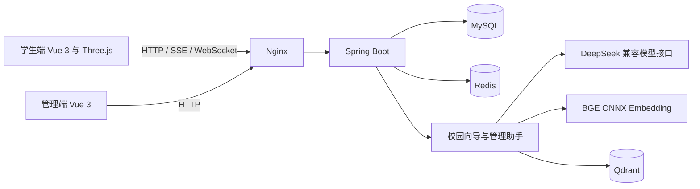

# 梧桐校园 · 三维交互式智慧校园服务平台

梧桐校园由 **Vue 3 学生端、Vue 3 管理端和 Spring Boot 后端**组成。学生可以在普通网页或 Three.js 校园里使用活动报名、闲置互换、失物认领、学习互助和实时交流。学生端校园向导连接实时业务和知识库，管理端智能助手连接待办查询、审核确认与公告草稿。

[功能](#功能) · [智能助手与 RAG](#智能助手与-rag) · [技术架构](#技术架构) · [Docker 快速启动](#docker-快速启动) · [开发与测试](#开发与测试) · [部署说明](./部署说明.md)

## 功能

| 模块 | 已实现的流程 |
| --- | --- |
| 校园活动 | 发布与审核、浏览和报名、发布者审批、候补与限时递补、七天日程、报名冲突提示、活动前站内提醒、签到及 CSV 导出 |
| 闲置互换 | 发布、分类搜索、收藏、预约、接受或拒绝、交接安排与改约、提醒、双方确认与评价 |
| 失物招领 | 寻物与拾到登记、搜索与候选匹配、申请认领、发布者核实、确认领回 |
| 学习互助 | 学习搭子发布与匹配、互助提问与采纳、代码纠错、OCR 错题录入和复习 |
| 校园社区 | 动态发布与按需加载图片、评论、点赞、收藏、分享、私信和举报 |
| 你画我猜 | 公开房、私密房、房间码加入、WebSocket 同步画板、轮流作画、猜词、计分与作品展区 |
| 消息与公告 | 站内公告、审核和预约结果通知、未读筛选与已读状态 |
| 管理后台 | 数据看板、用户管理、内容审核、内容上下架、举报、公告、AI 日志与系统配置。顶部搜索按学号、昵称、内容关键词或工单编号定位记录，返回搜索时恢复结果页码和焦点 |

### 学生日程、候补与交接

- **校园日程**在「我的报名 → 校园日程」中查看未来七天的安排和待复习题数。普通报名和校园向导的确认卡会提示时间重叠，学生仍可继续提交。已通过的活动会在开始前一小时内发送站内提醒。
- **活动候补**在满员活动的详情页加入，也可在「我的报名 → 我的候补」查看记录。有空位时按加入顺序递补，确认窗口最长 30 分钟，并受报名截止和活动开始时间限制。超时顺延，确认后仍由发布者审批。
- **闲置交接**在「我的预约 → 交接安排」中提出时间和地点，对方可以确认或提出改约。平台会在交接前一小时内提醒双方。到约定时间后，双方分别确认交接才能互评。已有预约仍支持原完成流程，也可选择约定交接。

**三维校园**入口为 `/campus-3d`。场景包含梧桐中庭及 12 个服务房间，支持环视、移动、导览定位、全屏和画质切换。房间内使用与普通网页相同的业务组件和账号状态。WebGL 无法启动时，仍可通过导览打开业务页面。

## 智能助手与 RAG

| 能力 | 实现 |
| --- | --- |
| 学生端校园向导 | 通过 Function Calling 调用活动、报名、闲置等业务工具，返回真实数据、原帖入口或操作确认卡。发布活动、提交报名和预约等写入操作由用户确认 |
| 管理端智能助手 | 查询实时待办、查看活动和闲置审核证据、按记录生成审核确认卡。支持公告草稿及管理资料问答 |
| 文档检索 | PDFBox 提取文本并按页切片。Embedding 服务使用 `bge-small-zh-v1.5` 的 ONNX 模型生成向量，Qdrant 检索相关切片，模型依据片段回答并附文档与页码 |
| 资料权限 | 公共资料、学生个人 PDF 和管理资料分别按文档范围与身份校验。工作台支持 PDF 预览、发布、撤回和重建索引 |
| 提示词与运行记录 | 工作台维护校园向导和资料问答的提示词版本，可切换生效版本并查看运行记录 |
| 学习辅助 | 智能对话支持 SSE 流式答复和历史会话。错题本支持 OCR 录入、整理、讲解、同类题和复习计划 |

可以在校园向导中输入「帮我发布活动：《校园读书会》」，打开草稿补齐地点和起止时间，再提交审核。管理端可查询待审记录并核对后确认，学生端可在「我的报名 → 我的发布」和消息中心查看结果。PDF 问答适用于可提取文字的 PDF，图片型扫描件需先做 OCR。

## 技术架构



- **后端**使用 Java 17、Spring Boot、MyBatis-Plus、JWT、BCrypt 和 Spring WebSocket。MySQL 保存业务记录、上传资源、文档切片和提示词版本，Redis 用于验证码、缓存与限流。
- **数据库访问**由 Mapper 层负责。常规增删改查使用 MyBatis-Plus，自定义 SQL 放在对应的 Mapper。Service 负责业务规则和事务。
- **前端**使用 Vue 3、Vite、Pinia、Vue Router、Element Plus 和 ECharts。Three.js 渲染校园场景，Tesseract.js 支持浏览器内的错题 OCR。
- **部署**使用 Docker Compose、Nginx 和多阶段构建。完整环境包含 MySQL、Redis、Spring Boot、两个 Web 端、Embedding 和 Qdrant，Agent 表结构由一次性迁移任务初始化。

## Docker 快速启动

需要 Git 和支持 `!override` 的 Docker Compose。首次构建会下载基础镜像、依赖和 Embedding 模型。以下以 Windows PowerShell 为例。

```powershell
git clone https://github.com/hongyucheng6258-glitch/Graduation-Project.git
Set-Location Graduation-Project

if (-not (Test-Path -LiteralPath .env)) {
    Copy-Item -LiteralPath .env.example -Destination .env
}
notepad .env
```

| 配置项 | 填写内容 |
| --- | --- |
| `MYSQL_ROOT_PASSWORD`、`REDIS_PASSWORD` | 各自的本机密码，均为必填项 |
| `JWT_SECRET`、`SIGNIN_SECRET` | 分别填写至少 32、16 字符的随机值 |
| `AI_API_KEY` | 体验模型问答和生成时填写有效密钥，也可在管理端配置 |
| `AI_BASE_URL`、`AI_MODEL` | 模板使用 DeepSeek 和 `deepseek-chat`，可按服务配置调整 |
| `STUDENT_PORT`、`ADMIN_PORT`、`BACKEND_PORT` | 建议设置为 `15173`、`15174`、`18080`。模板的后端端口是 `8080`，如沿用模板则使用 `8080` 检查后端 |
| `TRUSTED_ORIGINS` | 模板已含本机默认前端地址。修改端口或域名时同步更新 |

```powershell
$stack = @('-f', 'docker-compose.yml', '-f', 'docker-compose.agent.yml')
docker compose @stack up -d --build --wait
docker compose @stack ps -a
```

按上表建议端口启动后访问以下地址。`agent-migrate` 是一次性迁移任务，成功时显示 `Exited (0)`。

| 服务 | 地址 |
| --- | --- |
| 学生端 | [http://127.0.0.1:15173/](http://127.0.0.1:15173/) |
| 三维校园 | [http://127.0.0.1:15173/campus-3d](http://127.0.0.1:15173/campus-3d) |
| 管理端 | [http://127.0.0.1:15174/admin/](http://127.0.0.1:15174/admin/) |
| 后端就绪检查 | [http://127.0.0.1:18080/readyz](http://127.0.0.1:18080/readyz) |

### 初始化演示数据

完整 Compose 首次启动会初始化库表和本地初始管理员 `admin`，演示初始密码为 `admin123`，首次登录后应修改。学生可从前台注册，也可运行演示数据脚本生成学生账号 `CAMPUSDEMO01` 和业务样例。脚本生成的密码保存在指定的本机文件。演示 PDF 可在管理端「AI 配置 → 校园向导工作台」上传到公共知识库。 [演示数据导入说明](./docker/demo/README.md) · [演示 PDF](./docker/demo/knowledge/)

```powershell
docker compose @stack logs -f backend
docker compose @stack down
```

`down` 会保留数据卷。`down -v` 会移除 MySQL、Redis 和 Qdrant 的数据卷。环境变量、账号初始化、数据迁移和排错步骤见 [部署说明](./部署说明.md)。数据库备份目录和本机密钥由 Git 忽略。升级已有数据库时，全套 Compose 通过 `agent-migrate` 应用校园日程、候补与交接迁移。基础 Compose 的已有卷和手动部署需要先执行部署说明中的迁移脚本。

## 开发与测试

源码开发需要 Java 17、Maven、Node.js/npm、MySQL 和 Redis。本地 Vite 默认使用 `5173`、`5174`，代理到后端 `8080`。Java 服务的配置和 SQL 初始化见 [部署说明](./部署说明.md)。

### 在 IntelliJ IDEA 启动后端

1. 在仓库根目录按 Docker 快速启动一节准备 `.env`，再启动独立的开发数据库和 Redis。

   ```sh
   docker compose -p campus-idea -f docker-compose.yml -f docker-compose.idea.yml up -d --wait mysql redis
   ```

2. 在 `web/backend` 下创建 `.env.idea`，每行填写一个 `键=值`。填写 `MYSQL_PASSWORD`、`MYSQL_DB`、`REDIS_PASSWORD`、`JWT_SECRET` 和 `SIGNIN_SECRET`。MySQL 密码对应 Compose 使用的 `MYSQL_ROOT_PASSWORD`，库名默认为 `ai_campus_platform`，Redis 密码与开发容器一致。首次初始化后，MySQL 密码以现有数据库账户的实际密码为准。
3. 用 IDEA 打开 `web/backend`，等待 Maven 导入后，在右上角选择 **Campus Backend Local** 并运行。该配置会读取 `.env.idea`。启动后访问 [本地后端健康检查](http://127.0.0.1:18081/readyz)，确认返回 `READY`。
4. 若 Mapper 的表名标红，在 IDEA 的 **数据库**窗口添加 MySQL 数据源，主机填 `127.0.0.1`，端口填 `13306`，用户填 `root`，密码使用开发库密码。在 **Schemas（架构）** 中勾选 `ai_campus_platform` 后刷新。若编辑器仍有提示，用 **选择架构** 将 SQL 关联到该库。

联调前端时，在各自启动 Vite 的终端中设置 `CAMPUS_BACKEND_URL=http://127.0.0.1:18081`。用 PowerShell 时可执行 `$env:CAMPUS_BACKEND_URL = 'http://127.0.0.1:18081'`。

### 前端与测试命令

```powershell
npm.cmd --prefix web/frontend/student ci
npm.cmd --prefix web/frontend/admin ci

# 分别在两个终端运行
npm.cmd --prefix web/frontend/student run dev
npm.cmd --prefix web/frontend/admin run dev
```

```powershell
mvn -B -f web/backend/pom.xml test
$frontendTests = rg --files -g '*.test.mjs' web/frontend
$runnerTests = rg --files -g '*.test.cjs' tests/browser/e2e
node --test @frontendTests @runnerTests
```

如未安装 Ripgrep，可用 `Get-ChildItem -Recurse -File` 收集相同测试文件。浏览器和业务验收在独立 Compose 环境运行，使用独立账号、端口和数据卷。

| 测试入口 | 用途 |
| --- | --- |
| [run-all.cjs](./tests/browser/e2e/run-all.cjs) | 登录、审核、活动、闲置、失物、社交、AI、3D 与并发等端到端回归 |
| [search-and-assistant-ui.cjs](./tests/browser/e2e/search-and-assistant-ui.cjs) | 搜索分页返回、分类重试、助手故障入口、动态图片与 WebGL 降级 |
| [campus-workflows.cjs](./tests/browser/e2e/campus-workflows.cjs) | 多账号浏览器验证候补顺延、发布者审批、闲置改约、提醒和双方交接 |
| [activity-schedule.cjs](./tests/browser/e2e/activity-schedule.cjs) | 七天日程、普通报名与向导确认卡的冲突提示、提醒去重和状态过滤 |
| [agent-closure.cjs](./tests/browser/e2e/agent-closure.cjs) | 活动草稿、人工审核与通知，以及预约和重复确认 |
| [rag-eval.cjs](./tests/browser/e2e/rag-eval.cjs) | 公共资料、个人 PDF、管理资料、撤回与无依据问答评测 |

2026 年 11 月 12 日的端到端回归覆盖 20 类功能，146 项通过、0 项失败、0 项阻塞。另行通过校园日程与候补交接专项、双人实时画板、8 项 RAG 检查，以及主套件未执行的 AI 配额和未配置场景。后端 298 项通过、1 项按条件跳过，前端与测试运行器 104 项通过。[既有验收记录与答辩流程](./文档/04-测试与实验/分阶段验收与答辩演示.md)

## 项目结构

```text
web/backend/            Spring Boot、数据库迁移与后端测试
web/frontend/student/   学生端、Three.js 校园和实时画板
web/frontend/admin/     管理后台和管理智能助手
web/frontend/shared/    两端共用的助手界面
docker/                 镜像配置、Nginx、Embedding 和演示数据
tests/browser/          Playwright 浏览器测试与业务回归
文档/                   需求、系统设计、数据字典、接口与验收材料
```

[工程文档目录](./文档/README.md) · [数据库设计与数据字典](./文档/02-系统设计/数据库设计与数据字典.md) · [接口说明](./文档/03-接口与实现/接口说明书.md)
