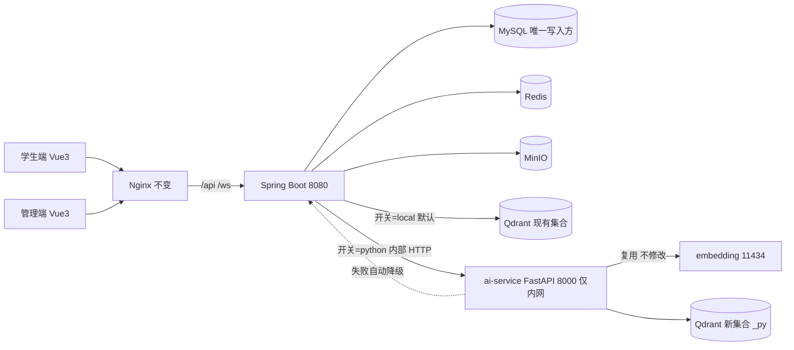

# AI 检索服务双后端拆分方案（Java + Python）

版本：v1.0 ｜ 状态：待评审，未实施 ｜ 适用范围：梧桐校园现有单体后端

## 1. 目标与硬性约束

在不改变现有系统任何对外行为的前提下，新增一个 Python 后端服务，承接 AI 检索链路（PDF 解析、切片、向量化、向量检索），Java 继续负责全部业务与事务。

**红线（任何阶段都不得违反）**

- 不修改数据库表结构，不新增迁移脚本，MySQL 仍只有 Java 一个写入方。
- 不修改前端代码、不修改 Nginx 配置、不修改现有 `docker-compose*.yml`、不修改部署脚本。
- 不改动 `module/ai/agent`（Function Calling 工具）与 `/ws`（私信、你画我猜）。
- Python 服务不占用宿主机端口，不加入现有 `backend` 的 `depends_on`，其故障不得影响 `backend` 启动与运行。
- 所有新能力由配置开关控制，**默认关闭**；关闭时系统行为与当前版本完全一致。
- 全程在独立分支开发，主分支随时可按现状部署。

## 2. 拆分依据（基于现状代码的量化判断）

| 范围 | 位置 | 规模 | 处置 |
| --- | --- | --- | --- |
| RAG 检索链路 | `module/ai/rag` | 1,004 行 / 8 个类 | 一期迁移其中的解析与检索部分 |
| 模型网关 | `module/ai/gateway` | 718 行 / 4 个类 | 二期可选，一期不动 |
| 业务工具编排 | `module/ai/agent` | 2,365 行 | 永久留在 Java |
| 管理端助手 | `module/ai/adminassistant` | 850 行 | 永久留在 Java |

关键事实：

- `KnowledgeVectorClient` 是 Java 侧唯一直连 Qdrant 与 embedding 服务的类，构造参数已全部外部化（`campus.agent.rag.*`），且已使用 `@ConditionalOnProperty` 装配。**这是唯一需要改动的接入点。**
- `docker/embedding/server.py` 已是一个独立部署的 Python 服务（Python 3.11、ONNX Runtime、监听 11434）。新服务复用它的部署范式与 HTTP 接口，**不修改该文件**。
- 现有向量集合为 `campus_bge_small_onnx_v1`，新服务使用独立集合，互不读写。

## 3. 目标架构



要点：Python 服务在一期**不暴露给前端、不经过 Nginx**，只是 Java 的一个内部下游。对外只有 Java 一个入口，因此前端、Nginx、鉴权、限流、维护模式拦截全部保持原样。

## 4. 职责边界与数据归属

| 能力 | Java | Python |
| --- | --- | --- |
| 上传、发布、撤回、权限校验、配额 | 全部保留 | 无 |
| 文档状态与版本号（MySQL） | 唯一写入方 | 只回传结果，由 Java 落库 |
| PDF 文本提取、切片 | 保留原实现作降级路径 | 新实现（PyMuPDF） |
| 向量检索 | 保留原实现作降级路径 | 新实现（qdrant-client） |
| 提示词拼装、答案生成、引用格式 | 全部保留 | 无 |
| Function Calling 业务工具 | 全部保留 | 无 |
| 业务数据读取 | 直接读 MySQL | **禁止直连 MySQL**，只接收 Java 传入的数据 |

文件传递采用**推送式**：Java 在索引任务中把文件字节、`documentId`、`version` 一并 POST 给 Python。Python 不需要 MinIO 凭证，也不需要任何数据库账号，凭证不扩散。

## 5. 接口契约（Java ↔ Python，仅容器内网）

统一约定：`Content-Type: application/json`；鉴权头 `X-Service-Token`（新增环境变量，两侧一致）；超时 25s（与现有 `KnowledgeVectorClient` 的 `callTimeout` 对齐）；失败返回非 2xx 与 `{"error": "..."}`。

| 接口 | 方法 | 用途 | 主要字段 |
| --- | --- | --- | --- |
| `/healthz` | GET | 健康检查，无需令牌 | `{"status":"ready"}` |
| `/internal/rag/index` | POST | 解析 + 切片 + 向量化 + 写入新集合 | 入：`documentId`、`ownerId`、`scope`、`version`、`fileBase64`、`chunkChars`；出：`chunks[{id,page,text}]`、`chunksCount`、`elapsedMs` |
| `/internal/rag/search` | POST | 向量检索 | 入：`question`、`userId`、`documentId?`、`internal`；出：`ids[]` |
| `/internal/rag/collection` | DELETE | 删除指定文档向量 | 入：`documentId`、`version?`；出：`{"deleted":true}` |

检索返回 point id 而非正文，与现有 `KnowledgeVectorClient.search` 的返回类型一致：
正文仍由 Java 从 MySQL 读取，MySQL 保持切片文本的唯一真源，避免双写与版本漂移。

## 6. 配置项（全部为新增键，不改动已有键）

```bash
# 检索实现提供者：local=现有实现（默认） python=Python 服务
CAMPUS_AGENT_RAG_PROVIDER=local
# Python 服务内网地址与鉴权
CAMPUS_AI_SERVICE_URL=http://ai-service:8000
CAMPUS_AI_SERVICE_TOKEN=
# Python 调用失败时自动回退到 local 实现，默认开启
CAMPUS_AGENT_RAG_FALLBACK=true
# Python 侧独立向量集合，与现有集合隔离
CAMPUS_AI_RAG_COLLECTION=campus_bge_small_onnx_v1_py
```

Spring 侧对应 `campus.agent.rag.provider` / `campus.ai-service.*`，Python 侧对应同名环境变量。

## 7. 文件改动清单

**全部为新增文件**

```
web/ai-service/
  app/main.py                 # FastAPI 入口、/healthz、路由注册
  app/config.py               # pydantic-settings 读取环境变量
  app/errors.py               # 统一错误类型（状态码 + 中文信息）
  app/pdf_chunker.py          # PyMuPDF 提取 + 切片（重叠 80，与 PdfChunker 对齐）
  app/embed_client.py         # 调用现有 embedding:11434，不改该服务
  app/vector_store.py         # qdrant-client，集合名来自环境变量
  app/schemas.py              # 请求/响应模型，与第 5 节契约一致
  requirements.txt            # fastapi uvicorn httpx pydantic-settings qdrant-client pymupdf
  README.md                   # 接口、运行、测试与开关说明
  .gitignore                  # 忽略 .venv / __pycache__ / 比对编译产物
  tests/test_chunker.py       # 切片规则用例，固化 Java PdfChunker 行为
  tests/compare_with_java.py  # 与 Java 切分循环的逐段等价比对
  tests/ChunkRef.java         # 比对用的 Java 参考实现（去掉 PDFBox 依赖）
  tests/compare_pdf.py        # 真实 PDF 的跨语言比对（PDFBox vs PyMuPDF）
  tests/ComparePdf.java       # 复用项目真实 PdfChunker 的比对入口
docker/Dockerfile.ai-service  # python:3.11-slim，非 root 运行，与 Dockerfile.embedding 同范式
docker-compose.ai-service.yml # 独立叠加文件，不修改现有 yml
web/backend/.../ai/rag/PythonRagClient.java   # 新增，OkHttp 调用上述契约
```

**需要修改的既有文件**：`KnowledgeService.java` 三处分支（约 30 行）——检索取 id、
索引写切片、清理向量，各自在 `python.enabled()` 为真时才走新路径。`KnowledgeVectorClient.java`
保持不变，作为降级实现原样运行；默认 `local` 时新增代码一行都不执行。

`.env.example` 追加 4 个新键（默认 local），不涉及既有键。

`docker-compose.ai-service.yml` 中的服务定义要点：

- `expose: ["8000"]`，**不写 `ports`**，宿主机无端口占用。
- `deploy.resources.limits`：CPU 1.0、内存 1G，防止解析 PDF 时抢占同机 MySQL/后端资源。
- `restart: unless-stopped`，自带 `healthcheck`；**不被 `backend` 的 `depends_on` 引用**。
- 启动方式：`docker compose -f docker-compose.yml -f docker-compose.agent.yml -f docker-compose.ai-service.yml up -d`，省略最后一个文件即为原系统。

## 8. 分阶段实施

**阶段 0：旁路影子服务（对现有系统零改动，1～2 天）**

只新增文件，不改 `KnowledgeVectorClient`。Python 服务独立启动，用测试脚本对同一批文档、同一批问题分别调用 Java 现有接口与 Python 接口，记录切片数、检索命中、引用页码差异。此阶段系统完全没有接入新服务，可随时整体删除。

**阶段 1：开关接入，默认关闭（2～3 天）**

新增 `PythonRagClient`，在 `KnowledgeVectorClient` 加分支与降级。默认 `provider=local`，CI 与本地开发行为不变。仅在测试环境显式设为 `python` 进行回归。

**阶段 2：灰度与切换（2～3 天）**

测试环境全量跑通后，在演示环境打开开关观察；因为 Python 不直接对外，灰度粒度就是"是否启用新检索实现"，出问题改回 `local` 即可。是否在生产/答辩环境开启由你决定，不开启也不影响方案成立。

**阶段 3（可选二期，另立方案）：模型网关迁移**

`AiGatewayService` 的非流式 `internalChat` 可先迁，SSE 的 `streamChat` 涉及 Java 端 `SseEmitter` 透传与敏感词、会话记忆、配额的耦合，工作量和风险明显更高，**一期不做**。

## 9. 回滚方案

| 场景 | 操作 | 耗时 | 影响 |
| --- | --- | --- | --- |
| Python 检索结果异常 | 配置改回 `local`，重启 backend | < 1 分钟 | 无，回到现有实现 |
| Python 服务宕机 | 无需操作，`fallback=true` 自动走 local | 0 | 单次请求略增延迟，有日志 |
| 向量数据异常 | 删除 `_py` 集合并重建，原集合不受影响 | 分钟级 | 无 |
| 整体放弃方案 | 删除新增文件与 `ai-service` 容器，还原 `KnowledgeVectorClient` 一处改动 | < 10 分钟 | 无 |

数据库始终无需回滚，因为没有表结构变更。

## 10. 验证清单

1. **行为不变验证**：`provider=local` 下跑通现有 `src/test/java` 全部 55 个测试类，结果与主分支一致。
2. **切片一致性**：同一 PDF 在两种实现下的切片数、页码归属、重叠字符完全一致（`PdfChunker` 的 80 字符重叠与 500 段上限必须对齐）。
3. **检索一致性**：准备 ≥ 50 个真实问题，两种实现的引用文档与页码一致率 ≥ 95%，不一致项逐条记录原因。
4. **权限回归**：公共资料、学生个人 PDF、管理资料三种范围在新实现下的可见性完全一致。
5. **故障注入**：停掉 `ai-service` 后，知识问答仍可用（走降级），后端日志有明确降级记录，无 5xx 扩散。
6. **资源隔离**：批量索引时观察 MySQL 与 backend 延迟，确认 `ai-service` 的 CPU/内存限额生效。
7. **性能留档**：记录两种实现的检索 P50/P95 与索引进耗，作为论文与答辩的对比数据——这是"为什么需要第二个后端"的实证依据。

## 11. 风险与对策

| 风险 | 影响 | 对策 |
| --- | --- | --- |
| 两种切片策略不一致导致答案引用偏移 | 检索质量下降 | 阶段 0 先做切片对比，对齐后再接入 |
| Python 服务异常拖慢请求 | 响应变慢 | 25s 超时 + 自动降级 local |
| 解析占用 CPU 影响同机容器 | 全站变慢 | 容器资源限额 + 解析并发信号量（沿用 embedding 的 `BoundedSemaphore` 思路） |
| 服务间伪造调用 | 越权检索 | 仅内网暴露 + `X-Service-Token` + 不转发用户身份以外的任何凭证 |
| 双实现长期并存增加维护成本 | 后续改动要写两遍 | 论文阶段保留 local 作降级；稳定后可评估是否下线 |

## 12. 工作量估算

| 内容 | 估时 |
| --- | --- |
| Python 服务骨架、契约、部署文件 | 1～2 天 |
| PDF 解析与切片对齐、检索实现 | 2～3 天 |
| Java 侧接入、开关、降级 | 1 天 |
| 对比验证、故障注入、回归测试 | 2 天 |
| 文档与对比数据整理 | 1 天 |
| **合计** | **约 7～9 个工作日** |

二期模型网关如需实施，另估 5～7 个工作日，不在本方案承诺范围内。

## 13. 明确不做的事

不拆 WebSocket，不迁移 Function Calling 工具，不让 Python 直连 MySQL 或 MinIO，不改前端与 Nginx，不动现有 embedding 服务，不改表结构，不引入第三个后端语言。后续若确需 Go，仅限独立的图片处理或网关聚合服务，须另行评审。

## 14. 实施状态

已完成阶段 0 与阶段 1 的代码落地，全部按"默认关闭、失败降级、独立集合"实现。

| 项 | 状态 |
| --- | --- |
| `web/ai-service`（8 个模块 + 测试 + README） | 已完成 |
| `docker/Dockerfile.ai-service`、`docker-compose.ai-service.yml` | 已完成，`docker compose config` 合并校验通过 |
| `PythonRagClient.java` 与 `KnowledgeService` 三处分支 | 已完成，默认 `local` |
| `.env.example` 新增 4 个键 | 已完成 |
| 前端、Nginx、现有 compose、部署脚本、表结构 | 未改动 |

验证结果：

1. 切片规则用例 10 项全部通过（`python3 tests/test_chunker.py -v`）。
2. 与 Java 切分循环的等价比对 120 例、3 种段长，**0 例差异**（`python3 tests/compare_with_java.py`）。
3. 真实 PDF 跨语言比对（项目真实 `PdfChunker`/PDFBox 与 PyMuPDF）：
   ASCII 样例 14 段、中文样例 3 段，**段数、页码、段文本全部一致**（`python3 tests/compare_pdf.py`）。
   该项直接验证了"两种提取器导致页码偏移"这一最大风险，结论是可接受。
4. 服务可启动、路由与鉴权冒烟通过：`/healthz` 200；无令牌 401；令牌正确但下游 embedding 不可用时
   返回 503 且带中文错误信息（验证降级路径会被触发）；请求模型不完整返回 422。
5. 全量编译已在 Docker 构建中验证通过（`docker/Dockerfile.backend` 使用 JDK 21 执行 `mvn package`，镜像构建成功）；
   本机仅有 JDK 25 且项目 Lombok 1.18.32 不支持 JDK 25，故本机 `mvn compile` 不可用，属环境限制而非代码问题。
6. `docker compose -f docker-compose.yml -f docker-compose.agent.yml -f docker-compose.ai-service.yml config`
   校验通过：`ai-service` 无宿主机端口映射、有限额与健康检查、`backend` 未新增对它的依赖，
   且切片长度、查询截断、向量模型三项取值与 `backend` 现有配置逐项一致。

### 真实环境验证（本机 Docker 叠加编排）

在本机用 `docker-compose.yml + docker-compose.agent.yml + docker-compose.ai-service.yml` 实起一套，
临时把后端切到 `provider=python` 完成下列验证，事后已恢复并清理测试数据。

| 验证项 | 结果 |
| --- | --- |
| 叠加编排启动 | mysql / redis / qdrant / embedding / backend / ai-service 全部 healthy；首次构建暴露 ai-service 源码 600 权限导致 `PermissionError`，已在 Dockerfile 用 `--chown` + `chmod` 修复 |
| ai-service 内部链路 | 中文 2 页 PDF → 3 段，索引耗时 283ms；ADMIN 可见、非内部检索 0 命中 |
| Java 客户端实测（线上部署的 `PythonRagClient`） | 索引 3 段；PUBLIC 两个用户各 3 命中；PRIVATE 仅本人 3 命中、他人 0；删除成功 |
| 应用内端到端 | 临时学生账号上传 PDF → 索引 `READY` → 问答返回正确内容，引用 `sample-cn.pdf` 第 1 页 |
| 双存储一致性 | MySQL `kb_chunk` 3 行 ↔ Qdrant 新集合 3 点；旧集合同文档 0 点，完全隔离 |
| 故障注入 | 停掉 ai-service 后问答仍 HTTP 200、返回"资料中未查到…"，后端日志出现"回退本地检索"；恢复服务后引用自动恢复 |
| 清理 | 删除测试文档后两个集合向量均清零；临时账号、PDF 与知识库记录已从库中移除；容器已 down |

### 50 问题检索一致性评估（真实业务语料）

语料取 `docker/demo/knowledge` 下 6 份业务指南，合成为 1 份 6 页 PDF；50 个问题按各页章节
内容编写（每页 8～9 题），覆盖登记、认领、预约、交接、采纳、签到、索引、举报等流程点。
同一份文档分别由 Java 本地实现与 Python 服务建索引，对 50 题比较 top-5 结果。

| 指标 | 结果 |
| --- | --- |
| 切片数 | local 6 / python 6 |
| 索引耗时 | local 728ms / python 485ms |
| top-1 页码一致率 | **100%**（50/50） |
| top-1 切片文本一致率 | **100%**（50/50） |
| top-5 页码集合平均 Jaccard | **1.000** |
| 不一致条目 | **0** |
| 目标页命中率 | local 80% / python 80% |
| 单次检索延迟 | local P50 4ms / P95 13ms；python P50 5ms / P95 17ms |

结论：在相同语料与相同问题下，两种实现的检索结果完全一致，Python 服务只增加约 1～4ms 网络开销。
目标页命中率 80% 为两个实现共同的水平，属于检索质量本身，不是拆分引入的差异。

复现方式：切片比对见 `web/ai-service/tests/compare_with_java.py` 与 `compare_pdf.py`；检索比对见
`web/ai-service/tests/RagConsistencyEval.java`（题目在 `questions-50.txt`），需在容器网络内运行；
应用层的验收可配合 `tests/browser/e2e/rag-eval.cjs`。

剩余可选项：在更大语料（如 50 页以上文档）上重复本评估，观察长文档分段边界的影响。
