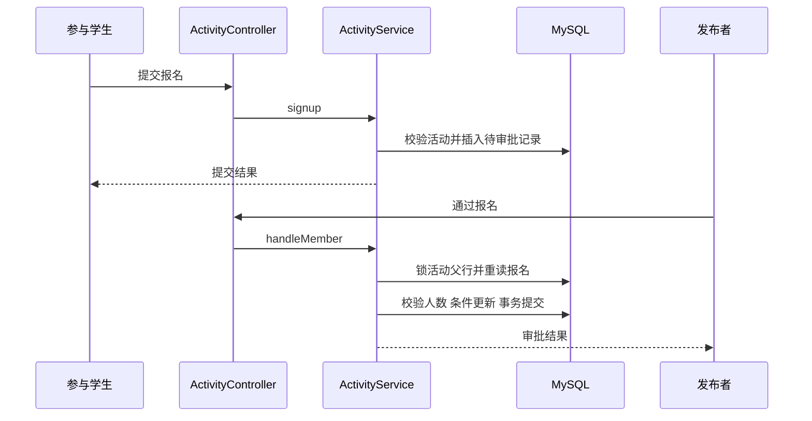
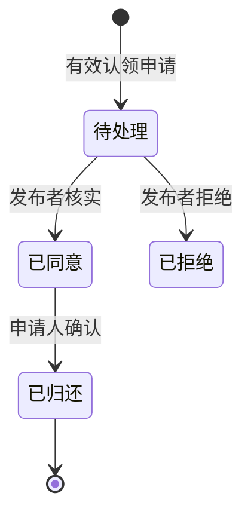

# 关键业务详细设计说明书

本文解释业务状态、操作者、持久化操作与并发约束。表中的状态值按源码常量及 Service 实现整理，不能仅根据页面文字推断数据库枚举。

## 活动报名与签到

### 数据与状态

核心对象为 activity、activity_member、activity_signin。活动的持久化状态为 0 报名中、1 满员、2 已结束、3 下架；展示状态还结合开始、结束和截止时间计算，使用独立的 0 至 5 枚举。两套状态不能互换保存。

| 对象 | 值 | 含义 | 转换与限制 |
|---|---|---|---|
| 报名记录 | 0 | 待审批 | 报名成功后创建 |
| 报名记录 | 1 | 已通过 | 发布者通过审批，并校验活动与名额 |
| 报名记录 | 2 | 已拒绝 | 发布者拒绝审批 |
| 签到记录 | 记录存在 | 已签到 | 校验签名与参与资格后插入，联合唯一约束防重复 |
| 报名取消 | 删除记录 | 不保留取消状态行 | 取消分支检查活动结束与签到；实现删除报名行 |

报名先校验活动与用户身份，再查询已有记录，插入时通过 activity_id、user_id 联合唯一约束兜底重复请求。审批使用 READ_COMMITTED 事务，先锁活动父行，再重读报名记录并检查当前状态；通过条件更新确认该记录仍待审批。这样对同一活动的不同报名审批可以按同一父行串行裁决名额。

取消报名流程与审批流程的锁使用并不完全一致。后续应在隔离环境验证“取消与审批交错执行”和“满员后取消再报名”等边界，而不能仅凭审批上的行锁认为整个活动生命周期已经验证安全。

## 闲置预约与评价

物品状态为 0 在架、1 已预约、2 已完成、3 已下架。预约状态为 0 待处理、1 已接受、2 已拒绝、3 已完成、4 已取消；取消值存在于常量，不代表已提供完整取消入口。

预约的关键在于以“当前仍在架”为条件更新物品状态。只有影响行数符合预期的请求才继续创建预约；其他请求得到已预约或状态变化的反馈。事务将状态变化与预约记录关联，避免同时产生多条有效预约。

| 操作 | 操作者 | 前置条件 | 结果 |
|---|---|---|---|
| 发起预约 | 非发布者学生 | 物品可预约 | 物品进入已预约，生成待处理预约 |
| 接受 | 该预约卖方 | 预约待处理 | 预约进入已接受 |
| 拒绝 | 该预约卖方 | 预约待处理 | 预约已拒绝，符合条件的物品恢复在架 |
| 确认完成 | 买方与卖方分别确认 | 新预约已确认交接安排并到达约定时间 | 双方确认后，预约与物品进入已完成 |
| 评价 | 交易参与方 | 预约已完成且本人未评价 | 保存 1 至 5 分及评价，唯一索引防重复 |

历史预约没有交接安排记录时沿用单方确认完成。新预约的交接安排、双方确认及后续评价按顺序办理。

## 失物认领

lost_found 的类型区分寻物与招领，状态为进行中、已完成、已下架。lost_found_claim 使用 0 待处理、1 已同意、2 已拒绝、3 已归还。发起认领针对招领信息，发布者不能认领自己的记录。

申请、核实和确认流程统一先锁失物父行，再处理认领记录，以降低不同入口反向持锁的问题。有效申请统计使用当前读；处理申请时校验发布者身份；申请人确认归还使用条件更新判定申请是否仍为已同意，再更新失物状态。

## 错题复习

用户提交的 masteryLevel 是掌握程度自评，服务端由它推导本次 isCorrect。它不是独立自动判题结果。复习事务写入 wrong_question_review 并更新 wrong_question。

| 掌握程度 | 状态变化 | 连续正确次数 | 下次复习 |
|---|---|---|---|
| 0 仍然不会 | 待复习，错误次数增加 | 清零 | 当前时间 |
| 1 有点理解 | 复习中 | 清零 | 1 天后 |
| 2 基本掌握 | 基本掌握；连续次数达到 3 时转已掌握 | 加 1 | 按新的连续次数取 1／3／7 天间隔 |
| 3 已完全掌握 | 基本掌握；连续次数达到 2 时转已掌握 | 加 1 | 按新的连续次数取 1／3／7 天间隔 |

上述时间依据 reviewIntervalDays 的实际调用，而不是方法注释中对“基本掌握”“已完全掌握”的简写。掌握度分数按状态映射为 5、30、70、100。对同类题保存要校验生成记录归属，并保持重复保存的幂等处理。

## AI 请求与输出

普通对话、PDF 问答、错题服务和发布辅助经过不同业务编排，但最终使用统一网关。网关准备系统提示词、上下文和用户输入，调用外部模型并记录结果。结构化场景还需解析 JSON，并校验候选 ID、空结果和格式异常。

校园向导先按关键词判定意图，再从业务表取相关数据。个人报名查询使用当前用户 ID；示例静态信息需要单独维护。PDF 问答需先检查文档归属与文本提取状态。扫描件会返回 PDF_SCANNED 对应的业务结果，不应展示为已成功完成文本问答。

前端请求代次和取消机制用于避免旧会话结果覆盖当前会话；这与真正让模型停止计费不是同一个保证。现有配置中的重试参数应结合各调用路径检查，不能仅因存在 retry_times 字段就声称所有请求已自动重试。

## 三维房间工作区

三维服务注册表负责服务 ID、分区、房间号、名称和页面入口。场景模块只发送进入房间或交互事件，工作区创建独立 Vue 应用和内存路由并挂载 RouterView。原页面继续使用后端接口及共享 Pinia 状态。

路由切换时记录滚动，列表通过注入状态保存筛选与分页。挂载使用代次标识避免旧异步任务在新工作区生效；关闭时卸载应用、清理观察器并释放路由关联。Escape 的处理先让内部弹窗或图片预览消费，再考虑返回房间，以减少多层窗口一起关闭。

## 私信与多人游戏

私信建立会话后以消息 ID、客户端消息 ID、发送者和资源归属保持消息一致性。客户端消息 ID 配合 sender_id 联合唯一约束处理重复发送。图片消息应关联合法上传资源；拉黑关系与发送限制在后端检查。

WebSocket 建连前通过受保护 HTTP 接口获取短期一次性票据，服务端通过 Redis getAndDelete 消费。私信与游戏使用独立票据前缀、处理器和端点，游戏票据还关联房间。

游戏状态由服务端维护 WAITING、PLAYING、FINISHED，当前规则为 2 至 6 人，每个回合计时 60 秒。画笔消息中的点坐标归一化到 0 至 1，单笔点数上限为 64。服务端校验当前画者与回合，猜词、得分和截止时间不能由客户端自行决定。已结束画布可保存作品，查看范围还需要按房间权限判定。

## 内容治理状态

审核状态为 0 待审核、1 通过、2 驳回，与各业务的“完成”“下架”等状态分开。ContentAiAuditService 仅在低风险且原本待审核时自动改为通过；中高风险保留待审核，并不意味着所有高风险都已自动写为驳回。AI 异常时按本地规则回退，需要人工复核的内容不能被当作 AI 成功审核。

## 源码依据

- [活动服务](../../web/backend/src/main/java/com/campus/platform/module/activity/service/ActivityService.java)。
- [闲置服务](../../web/backend/src/main/java/com/campus/platform/module/idle/service/IdleService.java)。
- [失物服务](../../web/backend/src/main/java/com/campus/platform/module/lostfound/service/LostFoundService.java)。
- [错题服务](../../web/backend/src/main/java/com/campus/platform/module/ai/service/WrongQuestionService.java)。
- [房间工作区](../../web/frontend/student/src/views/campus3d/CampusWorkspace.vue)、[游戏领域规则](../../web/backend/src/main/java/com/campus/platform/module/drawgame/domain/DrawGuessGame.java)。
