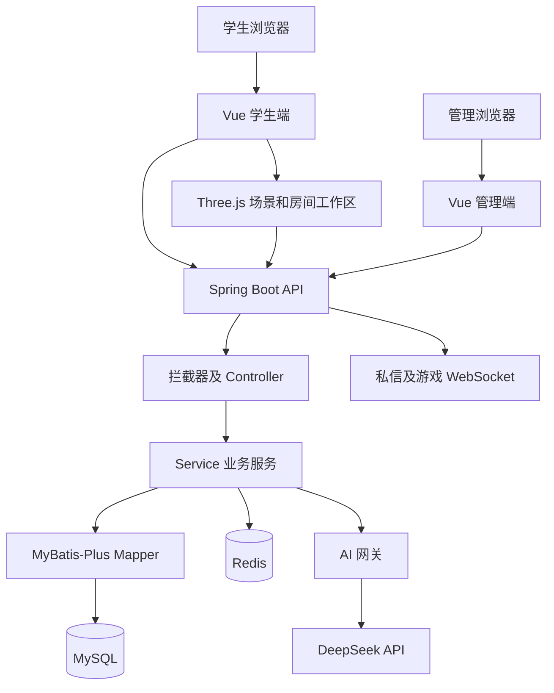

# 系统总体设计说明书

系统采用前后端分离架构。学生端和管理端作为独立 Vue 应用，通过同一后端访问业务数据。三维校园是学生端的一种服务组织方式，AI 是业务服务调用的外部能力，两者都围绕现有业务模型集成。

## 逻辑架构

## 分层职责

| 层次 | 负责内容 | 不应混淆的边界 |
|---|---|---|
| 页面与组件 | 表单、列表、状态展示、用户操作和可访问性 | 页面隐藏按钮不能代替服务端授权 |
| API 与状态管理 | Axios 请求、登录态、消息状态、失败处理 | 接口错误应保持为错误，不改写为演示成功 |
| 三维空间 | 几何、移动、导览、房间交互和渲染生命周期 | 不在场景代码复制活动、预约等业务规则 |
| Controller | 路由、参数接收、基本校验、调用服务和返回 | 与资源归属、事务条件等服务层规则配合 |
| Service | 权限、状态、事务、通知、AI 编排和输出处理 | 外部模型回答不直接等于数据库业务事实 |
| Mapper 与数据库 | 查询、分页、条件更新、行锁和持久化约束 | 应用逻辑关联与物理外键需要分别标注 |

## 模块划分

| 模块组 | 后端目录 | 设计职责 |
|---|---|---|
| 身份与用户 | auth、user、admin | 注册登录、资料、用户管理和管理员权限 |
| 校园事务 | activity、idle、lostfound | 活动参与、闲置预约、失物认领等状态流程 |
| 学习与社区 | partner、qa、post、favorite | 学习搭子、问答、动态和收藏 |
| 实时与通知 | chat、drawgame、message | 私信、游戏协议、站内通知与未读 |
| 治理与公共服务 | notice、report、site、upload | 公告、举报、配置、首页聚合与资源 |
| AI | ai | 会话、文档、错题、提示词、匹配推荐与调用网关 |

## 部署结构

Compose 定义 mysql、redis、backend、student、admin 五个服务。MySQL 和 Redis 在容器网络中供后端访问，前端 Nginx 将 /api 请求转发至 backend:8080；学生端同时代理 /ws。后端就绪依赖 MySQL 和 Redis 检查通过，前端在后端就绪后启动。

当前模板将学生端和管理端分别映射至宿主机 15173、15174，后端映射至 8080。数据库与 Redis 使用命名卷保存数据。首次创建空数据库卷时执行挂载的表结构和演示 SQL；已有卷不会随重启自动重置。

本地 Vite 开发与 Compose 端口映射是两套配置。Vite 默认端口为 5173、5174，代理后端 8080；更改开发端口时还需要调整可信 Origin。

## 请求及数据流

普通业务采用 JSON HTTP 接口。学生端接口统一放在 /api 下，管理员接口位于 /api/admin。成功与大部分业务失败使用 R 包装，业务 code 与 HTTP 状态分别判断。

AI 流式回答通过 SSE 发送增量文本，前端处理会话切换、停止请求和迟到响应。私信与游戏分别使用 /ws/chat、/ws/draw-guess，建立连接前通过 HTTP 获取短期票据，减少长期令牌暴露在连接地址中的需要。

图片和上传资源主要以 Data URI 或 Base64 入库。PDF 先保存上传资源并提取文字，再按用户归属参与文档问答。该方案减少基础演示环境对独立对象存储的依赖，同时会增加数据库存储、备份和包大小压力。

## 三维服务复用

Campus3D 管理场景和选中服务，CampusWorkspace 创建独立 Vue 应用并使用 createMemoryHistory。房间内 RouterView 复用主学生端 routes 中的页面，Pinia 状态使用当前学生端状态实例，接口仍访问相同后端。

房间列表状态使用注入对象保留，滚动位置按路由路径记录。关闭或重新挂载时清理应用、观察器和请求路由关联；通过生命周期状态与请求代次减少迟到加载覆盖当前界面的风险。该设计复用已有表单、Markdown、图片和弹窗，而不是维护两套独立业务页面。

## AI 集成

AiChatService、CampusGuideService、AiAssistService 等服务准备业务输入，AiGatewayService 统一构造消息并调用模型。配置可来自数据库和环境变量，数据库非空配置优先。部分交互请求有每日额度控制，内部辅助调用的处理路径不同，不能笼统声称所有场景共用相同额度。

校园向导以关键词识别意图并查询业务表，随后注入上下文。现有实现不等于向量数据库检索或自主训练模型。结构化场景解析模型 JSON，并核对返回候选与业务数据，避免将模型自由文本直接作为业务 ID 写入。

## 权限与治理

维护模式拦截器先处理学生接口，管理接口保留维护入口。学生拦截器按 HTTP 方法和具体路径放行公开读取，保护写入及个人端点。管理员拦截器校验角色、账号状态及令牌撤销时间；超级管理员操作再经过细粒度检查。

内容审核将本地规则、按配置启用的 AI 预审和人工审核衔接。低风险可通过，中高风险保留人工审核。内容通过后仍可能进入举报、下架和恢复流程，审核状态与业务可展示状态应分别处理。

## 设计取舍及后续验证

采用模块化单体便于在单一后端内协调事务与状态，当前资料不将其描述为微服务系统。三维入口和普通页面复用降低重复维护成本，但仍需验证低端设备的显存、帧率和页面内存。AI 统一网关便于日志与配置管理，但需要控制业务上下文的隐私、长度、成本和外部依赖故障。

基础 Compose 适合本地演示；公网部署、备份恢复、日志脱敏及容量要求需要根据实际环境继续验证。

## 源码依据

- [Compose 配置](../../docker-compose.yml)、[学生端 Nginx](../../docker/nginx/student.conf)、[管理端 Nginx](../../docker/nginx/admin.conf)。
- [Web 配置](../../web/backend/src/main/java/com/campus/platform/config/WebMvcConfig.java)。
- [三维房间工作区](../../web/frontend/student/src/views/campus3d/CampusWorkspace.vue)、[内存路由](../../web/frontend/student/src/features/campus3d/room-router.mjs)。
- [AI 网关](../../web/backend/src/main/java/com/campus/platform/module/ai/gateway/AiGatewayService.java)。
